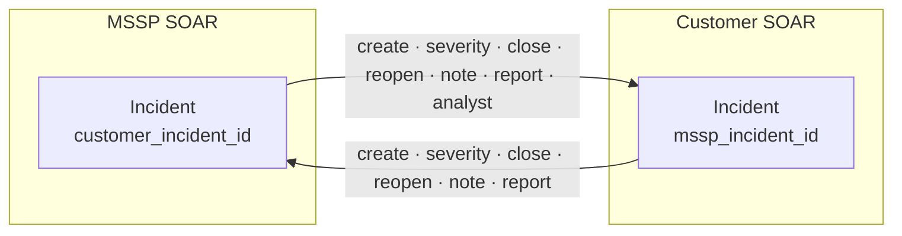

# IBM SOAR Incident Synchronization

[](https://github.com/AtakanUk/soar-incident-synchronization/actions/workflows/ci.yml)

[](LICENSE)

Keeps incidents in two IBM QRadar SOAR instances in step: the MSSP's SOC instance and the customer's own instance. When the SOC creates, updates or closes an incident, the linked incident on the customer side follows. Closing on the customer side is reflected back.

It also contains two one-off jobs used when the customer moved to a new SOAR installation: a bulk incident migration, and a backfill of the standard resolution field.

## How incidents are linked

Each side stores the other side's incident ID in a custom text field: `customer_incident_id` on MSSP incidents and `mssp_incident_id` on customer incidents (configurable). Select values such as severity and resolution have different IDs on each instance. They are translated by matching option labels, which are read from `/types/incident/fields` the first time they are needed. When labels differ, mappings can be overridden per direction.



## Synchronization actions

| Action | Direction | What happens |
| --- | --- | --- |
| `create` | both | Creates the linked incident with severity, description, dates, selected custom fields and fixed properties. Copies notes and tasks with their notes, then writes the new ID back to the source. It does nothing if the incident is already linked. |
| `severity` | both | Copies the severity. |
| `close` | both | Closes the linked incident with the translated resolution and the resolution summary. MSSP → customer also fills the customer's own close-reason field. It is skipped while the source is still open. |
| `reopen` | both | Reopens the linked incident if the source is active again. |
| `note` | both | Copies one note: the note that triggered the playbook (`note_id`), or the newest. |
| `report` | both | MSSP → customer: the notes of the "Describe the offense." and "Provide suggestions." tasks become the customer's report fields. Customer → MSSP copies those fields. |
| `analyst` | MSSP → customer | Sets the customer's `analyst_assigned` flag once an MSSP analyst picks the incident up. |

A failed action is logged and reported by e-mail (optional, Microsoft 365 SMTP with OAuth2). In the SOAR function the error also fails the function, so it shows in the playbook. Unknown select values are never copied as raw IDs. The action stops with a message naming the value to add to the override map.

### Running from playbooks

[soar_app/funct_incident_sync.py](soar_app/funct_incident_sync.py) is the component of a single SOAR function, `incident_sync`, with these inputs:

- `sync_action`
- `sync_direction`
- `incident_id`
- `note_id`

Generate the app with `resilient-sdk codegen`, add the function with these inputs, and create one playbook per trigger, for example "incident closed → `incident_sync` (close, mssp-to-customer)". The function keeps the field metadata in memory for the lifetime of the service.

The same actions can be run by hand:

```bash
python -m soar_incident_synchronization.cli sync create --incident-id 1001
python -m soar_incident_synchronization.cli sync close --incident-id 2002 --direction customer-to-mssp
python -m soar_incident_synchronization.cli sync note --incident-id 1001 --note-id 553
```

## Migration

```bash
# 1. discover field mappings and preview payloads, nothing is written
python -m soar_incident_synchronization.cli migrate --dry-run --limit 20 --payload-dir state/payloads
# 2. review/correct state/field_map.json, then migrate in batches
python -m soar_incident_synchronization.cli migrate --max-create 500
```

- **Payload**:
  - Copies incident fields and all custom fields that exist on the target, with translated select values.
  - Drops the link fields, which would point to IDs that don't exist on the target.
  - Stores the source ID in `SOAR_SYNC_MIGRATION_TRACKING_FIELD`.
  - If the target rejects the payload, the incident is created again with the core fields only.
- **Closed incidents without a resolution** get `SOAR_SYNC_MIGRATION_DEFAULT_RESOLUTION`, because SOAR refuses to create them otherwise.
- **Notes, tasks with their notes, and artifacts** are copied one by one. A failed item is counted and logged without stopping the incident.
- **Resumable**:
  - Progress and the source → target ID map are kept in the state file, written atomically.
  - Before creating an incident, the target is searched for the tracking ID, so a lost state file does not create duplicates.

## Resolution backfill

```bash
python -m soar_incident_synchronization.cli backfill-resolution --dry-run
python -m soar_incident_synchronization.cli backfill-resolution
```

For closed customer incidents, derives the standard `resolution_id` from the customer's close reason and adds a note with the change. For example, "Not an Issue" becomes "Non-Issue". "Action Taken" on an incident named like a test incident (`SOAR_SYNC_TEST_INCIDENT_MARKER`) becomes "Known Offense (Test)". Option IDs are resolved to labels and back through the field metadata. Processed incidents are recorded, and failed ones are retried on the next run.

## Configuration

Copy `.env.example` and fill it in. The main settings are:

| Variable | Description |
| --- | --- |
| `MSSP_SOAR_*`, `CUSTOMER_SOAR_*` | Host, org, API key and `CAFILE` (`true`, `false` or a CA bundle path) of each instance |
| `SOAR_SYNC_MSSP_REFERENCE_FIELD`, `SOAR_SYNC_CUSTOMER_REFERENCE_FIELD` | Link fields |
| `SOAR_SYNC_CUSTOMER_RESOLUTION_FIELD` | Customer's own close-reason select field |
| `SOAR_SYNC_REPORT_*_FIELD`, `SOAR_SYNC_MSSP_*_TASK` | Report fields and the MSSP tasks they are read from |
| `SOAR_SYNC_ANALYST_FIELD`, `SOAR_SYNC_ANALYST_ASSIGNED_FIELD` | Analyst assignment |
| `SOAR_SYNC_COPY_PROPERTY_FIELDS` | Custom fields copied when creating the linked incident |
| `SOAR_SYNC_CUSTOMER_CREATE_PROPERTIES_JSON`, `SOAR_SYNC_MSSP_CREATE_PROPERTIES_JSON` | Fixed custom field values for new incidents on each side |
| `SOAR_SYNC_OVERRIDE_MAPS_JSON` | Value mapping corrections per direction |
| `SOAR_SYNC_ERROR_MAIL_*` | Failure mail |
| `SOAR_SYNC_LOG_DIR`, `SOAR_SYNC_LOG_LEVEL` | Daily rotated logs, total size capped at 2 GB |

## Tests

```bash
pip install -r requirements.txt pytest
pytest
```

The tests run against an in-memory SOAR double that serves the REST endpoints used here. The real client code, patches included, is therefore exercised. They cover:

- every action in both directions
- value mapping and overrides
- migration: dry run, duplicate protection, fallback payload and create limit
- the resolution backfill

## License

[MIT](LICENSE)
